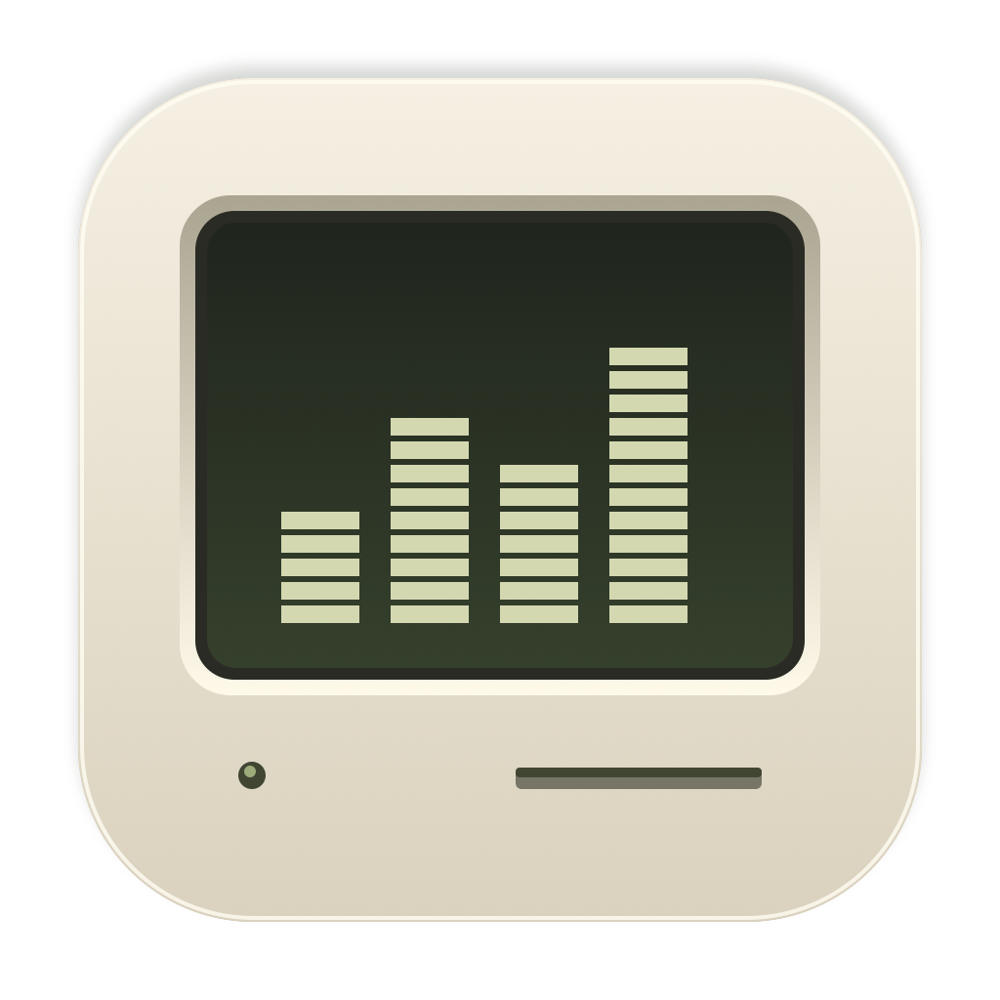

<p align="center">
  
</p>

# RetroStats

**메뉴바에서 Mac의 CPU·메모리를 모니터링하고, 재생성 가능한 유휴 캐시를 검사하고 복구 가능한 정리를 준비합니다.**

Apple Silicon용 네이티브 macOS 앱입니다.

## 설치

Apple Silicon, macOS 26 이상에서 한 줄 설치:

```sh
curl -fsSL https://raw.githubusercontent.com/oozoofrog/MiniStats/main/scripts/install.sh | sh
```

기본 설치 경로는 `~/Applications/RetroStats.app`이다. 설치 스크립트가 저장소를 클론하고 빌드·자체 검사를 거쳐 앱을 복사한다. 소스에서 직접 빌드하므로 공증(notarization)은 되어 있지 않다. 첫 실행 시 Gatekeeper 경고가 나면 앱을 우클릭하고 "열기"를 선택한다.

## 주요 기능

- **메뉴바 스토리지:** CPU·메모리 픽셀 숫자 뒤를 스토리지 사용량만큼 채움. 겹치는 숫자는 투명하게 배경을 드러내고 색은 macOS 메뉴바의 밝기·선택 상태를 따름. 상시 물결 애니메이션은 사용하지 않음
- **빠른 요약과 상세 창:** 메뉴바 클릭은 SwiftUI 요약 패널을 열고 닫음. CPU·메모리·송수신·디스크 여유 공간을 바로 확인하고 누른 행의 내용만 작은 대시보드로 전환. 재클릭하면 요약으로 돌아오며 다른 메뉴 위치와 전체 패널 크기는 유지. Open Dashboard로 별도 상세 창을 열 수 있음. 상세 창은 크기에 따라 상단 탐색과 사이드바로 전환하며, 요약 패널을 닫아도 유지됨
- **상태 유지:** 크기를 바꿔도 현재 페이지·스토리지 선택·실시간 측정 유지
- **업데이트 주기:** 설정에서 0.1~3.0초를 0.1초 간격으로 조절하며, 즉시 반영하고 재실행 후 유지
- **프로세스:** CPU·메모리 상위 3개 미리보기와 상위 5개 상세 정보
- **액정 잔상:** 계기판의 숫자와 그래프가 바뀔 때 이전 표시가 은은하게 사라짐. 동작 줄이기에서는 비활성화
- **안전한 디스크 정리:** 볼륨별 실제 여유 공간, 후보별 크기·이유·제외 사유, 선택 이동·복원과 전후 측정 기록
- **예약 미리보기:** 기본 비활성. 일간·주간 후보 검사만 수행하며 자동 삭제하지 않음. 이전 영구 삭제 예약은 새 기능에서 비활성으로 전환
- **My Mac 접속:** iPhone·iPad의 첫 설치·로그인·VPN 허용을 짧은 영어 문구와 도트 그래픽으로 안내. 연결 확인과 기기 식별을 자동으로 처리하고, 저장한 접속 링크에서 준비된 파일·화면·웹·터미널 서비스를 재사용. 상세 Tailscale 관리는 고급 화면에 보존
- **권한 설정:** Settings의 PERMISSIONS에서 저장 공간 알림 권한 요청·상태 재확인·시스템 설정 이동. 전체 디스크 접근·앱 관리 설정 옆에 실제 앱 파일을 드래그할 수 있는 아이콘 안내 창을 표시. 설정 창 이동을 따라가며 Finder 위치 표시도 제공. 전체 디스크 접근 승인은 사용자가 시스템 설정에서 수행
- **macOS 연동:** 로그인 시 자동 실행, 스토리지 알림, 활성 상태 보기·Finder 바로가기

클래식 매킨토시에서 착안한 줄무늬 타이틀바와 불투명 패널, 픽셀 글꼴을 사용합니다. 설정에서 Ivory·Platinum·Phosphor 마감과 글자 크기를 선택할 수 있으며, 모든 마감은 macOS 밝은/어두운 모드를 따릅니다.

## 안전한 디스크 정리

Storage의 `DISK CLEANUP`에서 `Preview Cleanup`으로 검사하고 원하는 후보를 선택한다. `Move Selected to Recovery`는 선택 항목만 `~/Library/Application Support/RetroStats/Recovery`로 원자적으로 이동한다. 원본과 같은 볼륨이어야 하며, 이 이동 자체는 공간을 확보하지 않는다. 영구 삭제·휴지통 비우기는 기본 화면에 없다. 사용자가 고른 별도 APFS 컨테이너·물리 외장 장치에 `Create Verified External Copy`로 사본을 만들 수 있다. 같은 컨테이너, 같은 물리 디스크의 다른 파티션, 가상·내장·미확인 장치는 차단한다. SHA256·ACL·확장 속성·resource fork·권한·소유자/그룹·수정 시각을 검증하며 원본을 유지한다. 이 복사는 공간 확보가 아니다. `Archive & Reclaim`은 이유를 표시하며 운영 UI와 엔진에서 비활성으로 유지한다. 제거 직전 교체·기존 열린 FD 쓰기 배제와 외장 사본 불변성을 보장할 근거가 없으므로 원본을 제거하지 않는다. RetroStats가 만든 복구·검증 파일도 제거 대상으로 삼지 않는다. 현재 지원 범위와 남은 검증은 [설치·검증 상태](docs/DISK_CLEANUP_INSTALL_PLAN.md)을 참조한다.

후보는 npm·pip·Homebrew·uv·Go의 알려진 재생성 캐시와 설치된 앱에 연결된 Sparkle 업데이트 캐시로 제한한다. 일반 앱 캐시·로그, 다운로드/DMG는 파일 이름만으로 정리 대상으로 삼지 않는다. 원본 소스·인증·앱 설정·컨테이너·CoreSimulator 사용자 데이터·사진·ebook·백업·검증 자료는 기본 범위 밖이다. DerivedData와 DeviceSupport는 현재 사용 여부를 별도로 확인해야 하므로 보호한다. 사용자 지정 DerivedData가 다른 볼륨에 있더라도 메인 디스크 확보량으로 표시하지 않는다.

7일 이내 수정/메타데이터 변경, 24시간 이내 루트/임시 폴더 활동, 실행 중 소유 앱·빌드·업데이트, 열린 파일, symlink·hard link·특수 파일·마운트·권한 미확인은 보존한다. 프로세스/열린 파일 조회가 불완전하거나 시간 제한에 걸리면 작업을 중단하며 추가 권한을 자동 요청·승인하지 않는다. 조회 직후 새 프로세스가 시작되는 경쟁 조건을 완전히 제거할 수는 없다.

검사·실행 사이 경로·파일 식별자·메타데이터와 일반 파일 SHA256을 재검증한다. 각 이동 전에 복구 receipt와 실행 의도를 저장하며, 이동 후 취소/실패해도 복구 사본을 재귀 삭제하지 않는다. `Items / recovery`에서 원본·사본 경로와 결과를 확인하고 `Restore`로 복원한다. 원본 경로가 재생성되거나 사본이 변경되면 덮어쓰지 않고 보존한다. 미복원·미완료 기록은 20회 제한에서 제외한다. 사본과 receipt는 자동 삭제하지 않는다.

볼륨별 여유 공간은 `statfs`의 실제 가용 블록으로 읽는다. Finder의 important-usage 용량과의 차이는 **purgeable 추정**으로 따로 표시한다. APFS 공유 컨테이너의 여유 공간은 볼륨별 값을 합산할 수 없다. 후보의 할당량, 이동한 용량과 실행 전후 실제 여유 변화도 별도로 표시하며, 동시 쓰기를 포함한 실측 변화를 해당 작업의 성과로 단정하지 않는다.

## 빌드와 실행

- 실행: Apple Silicon, macOS 26 이상
- 빌드: macOS 26 SDK 이상을 포함한 Xcode

```sh
make verify
open build/RetroStats.app
```

## 라이센스

대시보드와 메뉴바 계기는 직접 그린 5×7 고정 폭 글꼴 `RetroBitmapA`를 사용한다. 영문·숫자·기본 기호와 시안의 ‘한’, ‘글’은 글꼴 안에 픽셀 패턴으로 정의했고, 그 밖의 문자와 임의의 프로세스·파일 이름은 macOS 글리프를 선명한 픽셀 격자로 표시한다. macOS 알림·메뉴·대화상자는 시스템 글꼴을 따른다.

[최신 릴리스](https://github.com/oozoofrog/MiniStats/releases/latest) · [My Mac 사용 안내](docs/TAILSCALE_USER_GUIDE.md) · [개발 안내](docs/DEVELOPMENT.md) · [버그 제보·기능 제안](https://github.com/oozoofrog/MiniStats/issues)

외장 원본 제거 프로토타입은 명시적으로 opt-in한 고유 `/tmp/archive-home-UUID` 합성 home에서만 시험할 수 있으며, 운영 데이터에서는 허용되지 않는다. 사본 변경·용량 부족·취소·부분 실패·복원 충돌 회귀와 실제 다른 파일시스템 복사 검증을 제공하지만, 테스트 이미지 연결이 실패한 환경에서는 실제 분리 검증을 완료한 것으로 표시하지 않는다.
